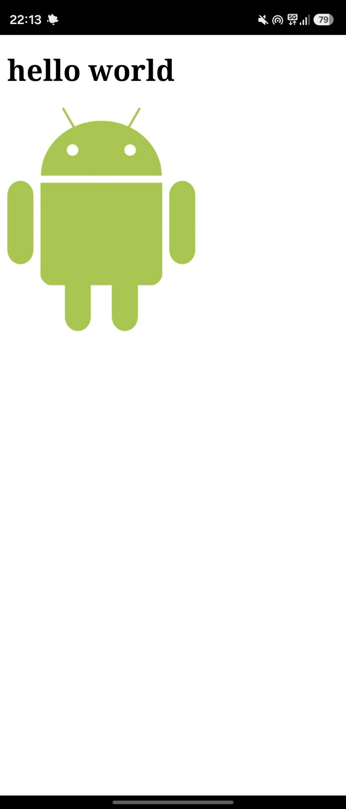
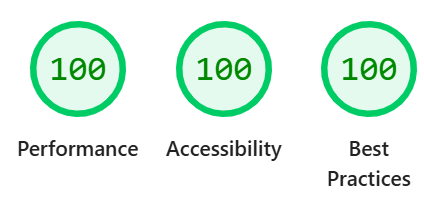

# ✧ Lab 01: Podstawy PWA ✧

**🌸 Adres wdrożonej aplikacji:** [https://lab1-54093.web.app/](https://lab1-54093.web.app/) 🌸

## ✦ Co zostało zrealizowane ✦
- Utworzono strukturę aplikacji w katalogu `public/` (HTML, JS, manifest oraz dedykowaną stronę `offline.html`).
- Skonfigurowano plik `manifest.json` oraz wygenerowano zestaw responsywnych ikon przy użyciu narzędzia `pwa-asset-generator`.
- Zaimplementowano Service Workera z wykorzystaniem biblioteki **Workbox**:
  - dodano precaching dla podstawowych zasobów aplikacji,
  - ustawiono strategię `NetworkFirst` dla podstron oraz `CacheFirst` dla grafik,
  - skonfigurowano fallback do `offline.html` w przypadku braku połączenia z siecią.
- Dodano własny przycisk instalacji oparty na zdarzeniu `beforeinstallprompt`.
- Wdrożono projekt na Firebase Hosting oraz zweryfikowano instalację na urządzeniu mobilnym.
- Przeprowadzono audyt w narzędziach deweloperskich (DevTools / Lighthouse), uzyskując wynik 100 w kategoriach *Accessibility* oraz *Best Practices*.

---

<div align="center">

### 🌸 Zrzuty ekranu 🌸

| Aplikacja na telefonie | Wynik audytu Lighthouse |
| :---: | :---: |
|  |  |

</div>

---

## ✦ Uruchomienie ✦
Wymagane środowisko: **Node.js**.

1. Przejdź do folderu z aplikacją:
   ```bash
   cd lab_01/public
   ```
2. Uruchom lokalny serwer testowy:
   ```bash
   npx serve
   ```
3. Otwórz w przeglądarce adres podany w terminalu.

---

## ✦ Trudności / refleksja (opcjonalnie) ✦

🌸 Brak. Wszystko super :D 🌸


