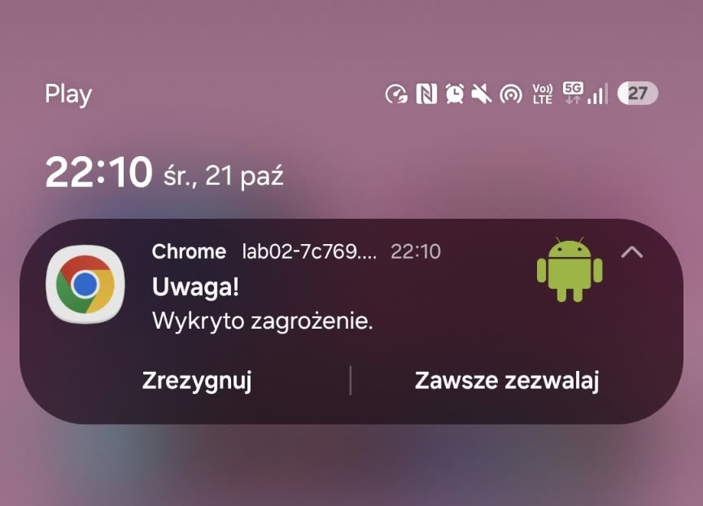

# ✧ Lab 02: Powiadomienia i Web Push ✧

**🌸 Adres wdrożonej aplikacji:** [https://lab02-7c769.web.app](https://lab02-7c769.web.app) 🌸

## ✦ Co zostało zrealizowane ✦
- Obsłużono sprawdzanie oraz dynamiczne żądanie uprawnień do powiadomień (`Notification API`) dopiero po interakcji użytkownika, z wizualną prezentacją bieżącego stanu (`default` / `granted` / `denied`).
- Zaimplementowano lokalne powiadomienia testowe:
  - tworzone bezpośrednio przez stronę (`new Notification()`),
  - wyświetlane z poziomu Service Workera (`registration.showNotification()`) z obsługą przejścia pod wskazany adres po kliknięciu (`notificationclick`).
- Dodano formularz umożliwiający wpisanie tytułu, treści oraz wybór jednej z trzech ikon powiadomienia.
- Wdrożono obsługę **Web Push**:
  - generowanie pary kluczy VAPID za pomocą biblioteki `web-push` w Node.js,
  - mechanizm subskrypcji (`pushManager.subscribe()`) i anulowania subskrypcji w przeglądarce wraz z kopiowaniem obiektu JSON do schowka,
  - odbieranie zdarzenia `push` w Service Workerze i wyświetlanie powiadomień nawet po zamknięciu karty aplikacji.
- Utworzono skrypt `send-push.mjs` do wysyłania powiadomień serwerowych z poziomu terminala.
- Opublikowano aplikację na platformie Firebase Hosting przez szyfrowane połączenie HTTPS i przetestowano odbiór powiadomień push na urządzeniu mobilnym.

---

<div align="center">

### 🌸 Zrzut ekranu 🌸

| Powiadomienie push na telefonie |
| :---: |
|  |

</div>

---

## ✦ Uruchomienie ✦
Wymagane środowisko: **Node.js**.

1. Przejdź do folderu z aplikacją:
   ```bash
   cd lab_02/public
   ```
2. Uruchom lokalny serwer testowy:
   ```bash
   npx serve
   ```
3. Otwórz w przeglądarce adres podany w terminalu.

4. Wysłanie powiadomienia push z terminala (serwer):
    ```bash
    cd lab_02
    node send-push.mjs "Tytuł" "Wiadomość wysłana z terminala"
    ```
    (Upewnij się, że w pliku subscription.json znajduje się aktualny obiekt subskrypcji skopiowany ze strony)
    
## ✦ Trudności / refleksja (opcjonalnie) ✦
🌸 Refleksja - jaki jest rekord kroków wykonanych przez prowadzącego podczas jednych labów. 🌸