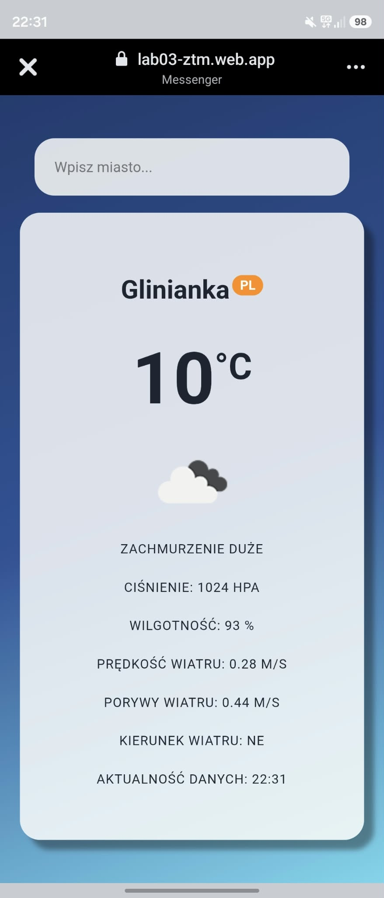
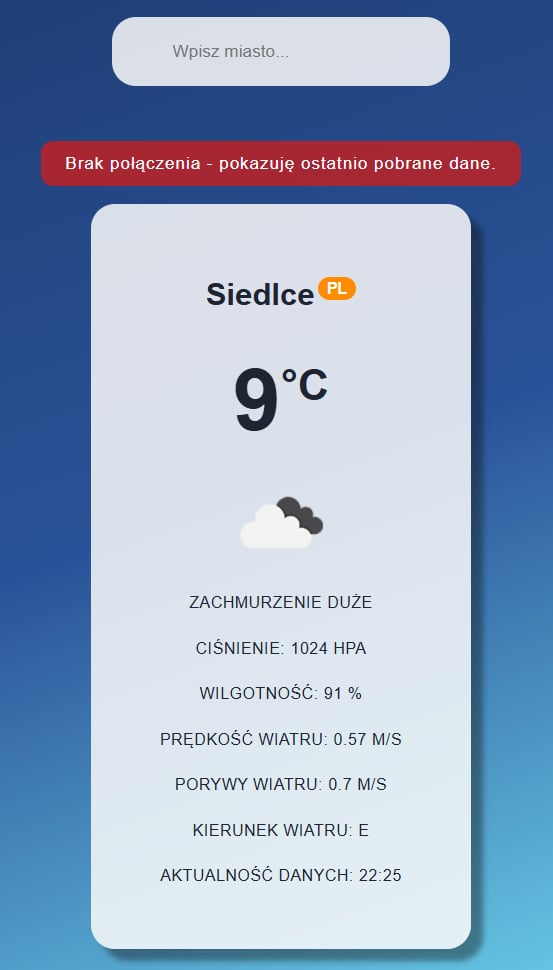

# ✧ Lab 03: Weather App – komunikacja sieciowa w PWA ✧

**🌸 Adres wdrożonej aplikacji:** [https://lab03-ztm.web.app](https://lab03-ztm.web.app) 🌸

## ✦ Co zostało zrealizowane ✦
- Zainicjalizowano i skonfigurowano projekt w oparciu o framework **React** oraz narzędzie **Vite**.
- Zaimplementowano asynchroniczną komunikację z internetowym API **OpenWeatherMap** (`Current Weather Data`) z użyciem natywnej funkcji `fetch()`:
  - normalizacja parametrów zapytania za pomocą `URLSearchParams` (konwersja nazw miast na małe litery, kodowanie znaków, jednostki metryczne `metric` oraz język polski `pl`),
  - obsługa błędów sieciowych i kodów odpowiedzi serwera (m.in. błąd `404` dla nieznanego miasta, `401` dla nieaktywnego klucza API, brak łączności `offline`).
- Zbudowano interfejs użytkownika w React zarządzany za pomocą hooka `useState`:
  - formularz wyszukiwania z blokowaniem domyślnego przeładowania strony (`e.preventDefault()`),
  - wizualne komunikaty o stanie ładowania (`loading`) oraz występujących błędach (`error`).
- Zrealizowano prezentację szczegółowych danych meteorologicznych na karcie miasta:
  - nazwa miejscowości wraz z kodem kraju w indeksie górnym,
  - aktualna temperatura zaokrąglona do pełnych stopni Celsjusza (`Math.round()`),
  - ikona stanu pogody pobierana bezpośrednio z serwisu OpenWeatherMap (`city-icon`) wraz z polskim opisem słownym,
  - parametry dodatkowe: ciśnienie atmosferyczne (hPa), wilgotność (%), prędkość wiatru (m/s), warunkowe wyświetlanie porywów wiatru (`wind.gust`),
  - przeliczenie kierunku wiatru ze stopni (`wind.deg`) na odpowiadające strony świata (np. NW, SE),
  - data i dokładna godzina pomiaru przeliczona z formatu timestamp na czas lokalny (`toLocaleTimeString`).
- Zaimplementowano dynamiczną detekcję stanu połączenia sieciowego z poziomu `useEffect` (nasłuchiwanie zdarzeń `online` oraz `offline` obiektu `window` z wartością startową `navigator.onLine`) i wyświetlanie ostrzeżenia o braku sieci nad kartą pogody.
- Przekształcono aplikację w pełnoprawną aplikację **PWA** przy użyciu `vite-plugin-pwa` i biblioteki **Workbox**:
  - wygenerowano komplet dedykowanych ikon aplikacji dla różnych rozdzielczości
  - skonfigurowano manifest aplikacji,
  - zdefiniowano reguły buforowania zasobów w Service Workerze (`runtimeCaching`):
    - strategia **`NetworkFirst`** dla zapytań do API pogody (z ograniczeniem czasowym `networkTimeoutSeconds: 5` oraz limitem wpisów i ważności w cache `weather-api`),
    - strategia **`CacheFirst`** dla statycznych ikon graficznych pogody w cache `weather-icons`.
- Przetestowano zachowanie Service Workera oraz odczyt zapamiętanych danych w trybie produkcyjnym po odcięciu sieci (`DevTools -> Network -> Offline`).
- Opublikowano kompletną aplikację produkcyjną na platformie **Firebase Hosting** z aktywnym certyfikatem SSL (HTTPS).

---

<div align="center">

### 🌸 Zrzuty ekranu 🌸

| Działanie aplikacji online (pobranie pogody) | Praca w trybie offline (dane z cache) |
| :---: | :---: |
|  |  |
</div>

---

## ✦ Uruchomienie ✦
Wymagane środowisko: **Node.js**.

1. Przejdź do folderu z projektem:
   ```bash
   cd lab_03
   ```
2. Zainstaluj wymagane zależności:
    ```bash
    npm install
    ```
3. Uruchomienie wersji deweloperskiej:
    ```bash
    npm run dev
    ```
4. Budowanie i podgląd produkcyjny z obsługą PWA / Service Workera:
    ```bash
    npm run build
    npm run preview
    ```
5. Wdrożenie na Firebase Hosting:
    ```bash
    firebase deploy
    ```

## ✦ Trudności / refleksja (opcjonalnie) ✦
🌸 Jednak istnieje lepszy skrót klawiszowy do formatowania kodu w Visualu niż spacja: `Shift + Alt + F`. 🌸