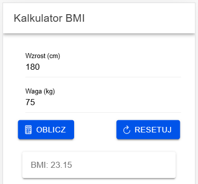
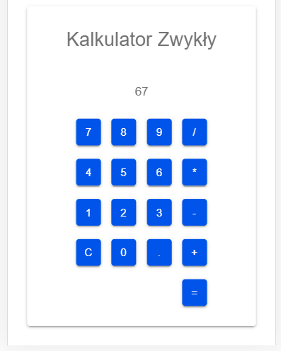

# ✧ Lab 04: Pierwsza aplikacja w Ionic React ✧

## ✦ Co zostało zrealizowane ✦
- Zainicjalizowano projekt mobilny oparty na **Ionic** z szablonem **React** oraz uporządkowano strukturę plików.
- Skonfigurowano podstawowy layout i motyw aplikacji mobilnej z wykorzystaniem komponentów biblioteki `@ionic/react` (`IonApp`, `IonHeader`, `IonToolbar`, `IonTitle`, `IonContent`).
- Zbudowano interaktywny formularz kalkulatora BMI:
  - wykorzystano komponenty siatki `IonGrid`, `IonRow` oraz `IonCol`,
  - dodano pola tekstowe `IonItem` + `IonInput` z pływającymi etykietami (`labelPlacement="floating"`),
  - pobieranie danych z pól formularza zrealizowano przez referencje hooka `useRef` z typowaniem `<HTMLIonInputElement>`,
  - dodano przyciski akcji `IonButton` z ikonami z pakietu `ionicons/icons` (`calculatorOutline`, `refreshOutline`),
  - zaimplementowano funkcję obliczania wskaźnika BMI oraz funkcję czyszczącą pola i stan,
  - wynik wyświetlany jest warunkowo w karcie `IonCard` i formatowany do dwóch miejsc po przecinku (`toFixed(2)`).
- Utworzono niezależny komponent kalkulatora standardowego (`Kalkulator.tsx`):
  - zarządzanie stanem kalkulatora oparto na trzech zmiennych stanu w hooku `useState`: bieżący tekst na wyświetlaczu (`wyswietlacz`), poprzednio wprowadzona liczba (`poprzednia`) oraz wybrany znak operacji (`operacja`),
  - dynamiczne renderowanie klawiatury kalkulatora z płaskiej tablicy znaków za pomocą metody `.map()` w siatce 4-kolumnowej (`size="3"`),
  - obsługa wyrównania przycisku znaku równości `=` do prawej krawędzi za pomocą właściwości `offset="9"`,
  - implementacja logiki arytmetycznej bez użycia niebezpiecznego `eval()` (instrukcja `switch` dla operatorów `+`, `-`, `*`, `/`),
  - obsługa błędu dzielenia przez zero z dedykowanym komunikatem tekstowym,
  - niwelowanie niedokładności operacji zmiennoprzecinkowych przy pomocy `parseFloat(wynik.toFixed(10))`.
- Przetestowano zachowanie interfejsu w widoku symulacji urządzeń mobilnych w DevTools.
---

<div align="center">

### 🌸 Zrzuty ekranu 🌸

| Kalkulator BMI | Kalkulator standardowy |
| :---: | :---: |
|  |  |
</div>

---

## ✦ Uruchomienie ✦
Wymagane środowisko: **Node.js** oraz zainstalowane **@ionic/cli**.

1. Przejdź do folderu z projektem:
   ```bash
   cd lab_04
   ```
2. Zainstaluj wymagane zależności:
    ```bash
    npm install
    ```
3. Uruchom serwer deweloperski aplikacji:
    ```bash
    npx ionic serve
    ```
4. Podgląd w widoku mobilnym: w przeglądarce otwórz narzędzia deweloperskie `(F12)`, a następnie włącz tryb responsywny.

## ✦ Trudności / refleksja (opcjonalnie) ✦
🌸 😴💤 🌸