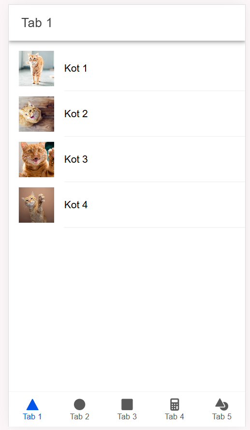
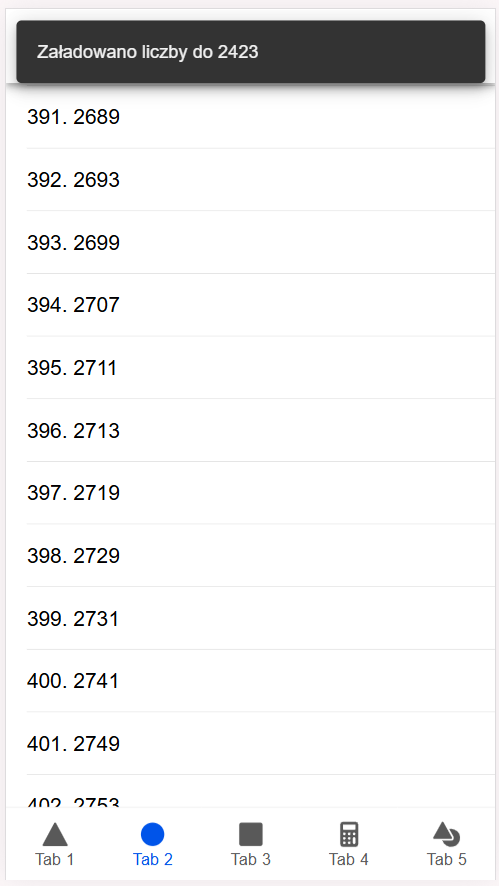
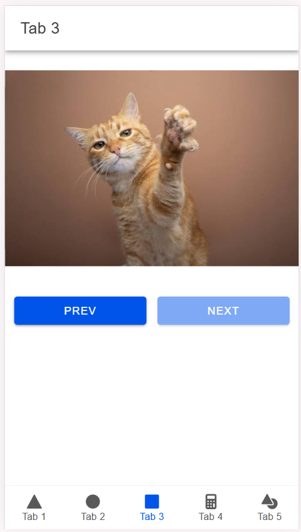
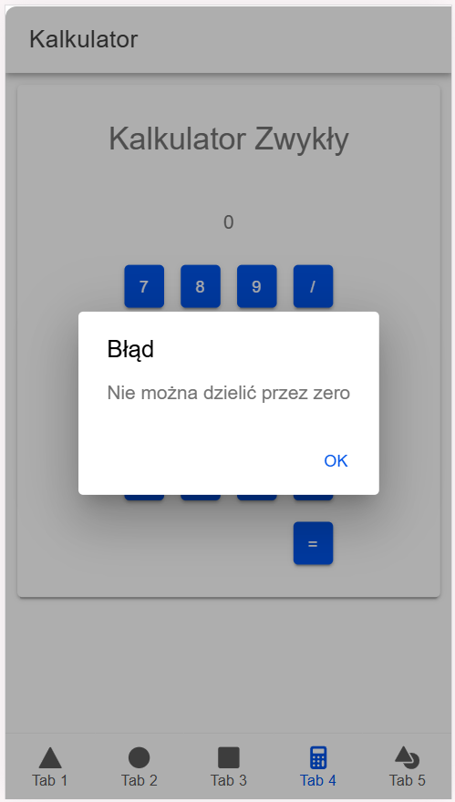
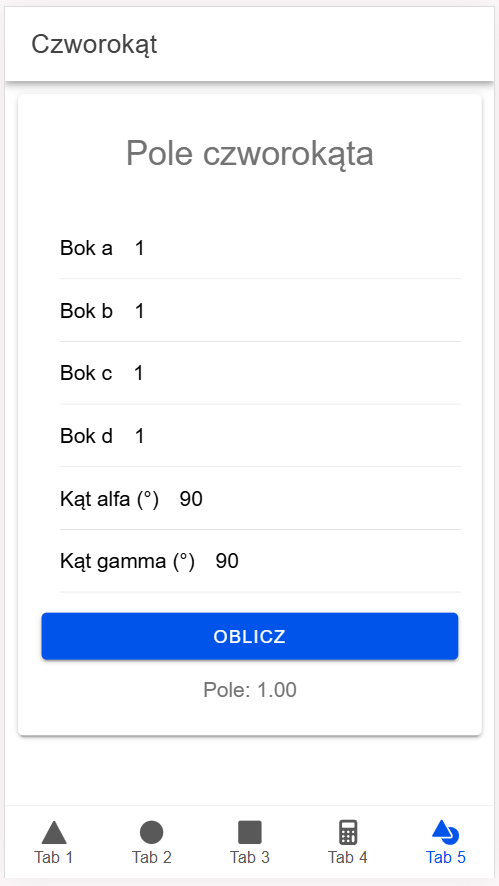

# ✧ Lab 05: Podstawowe komponenty Ionic React ✧

## ✦ Co zostało zrealizowane ✦
- Zainicjalizowano projekt mobilny oparty na **Ionic** z szablonem nawigacji zakładkowej (`tabs`) w **React** (`IonTabs`, `IonTabBar`, `IonTabButton`, `IonRouterOutlet`).
- Rozbudowano nawigację aplikacji o dwie nowe zakładki (`Tab4` - *Kalkulator* oraz `Tab5` - *Czworokąt*) wraz z przypisaniem tras (`Route`) i ikon z pakietu `ionicons/icons` (`calculator`, `shapes`).
- Przeniesiono komponent kalkulatora (`Kalkulator.tsx`) na dedykowaną zakładkę oraz zastąpiono tekstowy komunikat błędu dzielenia przez zero oknem dialogowym `IonAlert` sterowanym stanem `useState` i zdarzeniem `onDidDismiss`.
- Zbudowano listę obrazków z podpisami (`Tab1.tsx`) na podstawie tablicy danych z wykorzystaniem komponentów `IonList`, `IonItem`, `IonThumbnail`, `IonLabel` oraz znacznika `` z atrybutem `loading="lazy"`.
- Zaimplementowano nieskończone przewijanie listy liczb pierwszych (`Tab2.tsx`):
  - napisano funkcje pomocnicze `czyPierwsza` oraz `kolejnePierwsze` w TypeScripcie,
  - dodano dynamiczne doładowywanie kolejnych 20 liczb pierwszych przy przewijaniu z wykorzystaniem komponentów `IonInfiniteScroll` i `IonInfiniteScrollContent` (`ev.target.complete()`),
  - zrealizowano powiadomienia o zakresie załadowanych liczb za pomocą hooka `useIonToast` (`position: 'top'`).
- Stworzono interaktywny pokaz slajdów (`Tab3.tsx`) z użyciem biblioteki **Swiper** (`Swiper`, `SwiperSlide`):
  - obsłużono przesuwanie slajdów gestem oraz przyciskami `PREV` i `NEXT` w siatce `IonGrid` za pomocą instancji `SwiperType` (`slidePrev()`, `slideNext()`),
  - dodano automatyczne blokowanie przycisków na skrajnych slajdach (`isBeginning`, `isEnd`) w funkcji `onSlideChange`.
- Dodano formularz obliczający pole dowolnego czworokąta wypukłego ze wzoru Bretschneidera (`Tab5.tsx`):
  - pobieranie długości boków oraz kątów w stopniach zrealizowano przez referencje hooka `useRef` (`<HTMLIonInputElement>`),
  - zaimplementowano walidację danych wejściowych, przeliczenie stopni na radiany (`Math.PI / 180`) oraz wyświetlanie wyniku z dokładnością do dwóch miejsc po przecinku (`toFixed(2)`).
- Przetestowano działanie wszystkich widoków w trybie responsywnym (widok telefonu) w DevTools.

---

<div align="center">

### 🌸 Zrzuty ekranu 🌸

| Lista obrazków | Liczby pierwsze (Toast) | Pokaz slajdów |
| :---: | :---: | :---: |
|  |  |  |

| Kalkulator (Alert) | Pole czworokąta |
| :---: | :---: |
|  |  |
</div>

---

## ✦ Uruchomienie ✦
Wymagane środowisko: **Node.js** oraz zainstalowane **@ionic/cli**.

1. Przejdź do folderu z projektem:
   ```bash
   cd lab_05
   ```
2. Zainstaluj wymagane zależności (w tym bibliotekę swiper):
    ```bash
    npm install
    ```
3. Uruchom serwer deweloperski aplikacji:
    ```bash
    npx ionic serve
    ```
4. Podgląd w widoku mobilnym: w przeglądarce otwórz narzędzia deweloperskie, a następnie włącz tryb responsywny.

## ✦ Trudności / refleksja (opcjonalnie) ✦
🌸 Nadaję ze strefy czasowej Wybrzeża Kości Słoniowej. 🦴🐘 🌸
