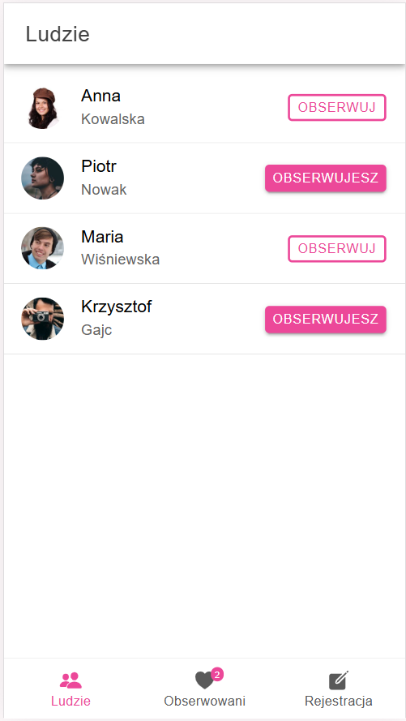
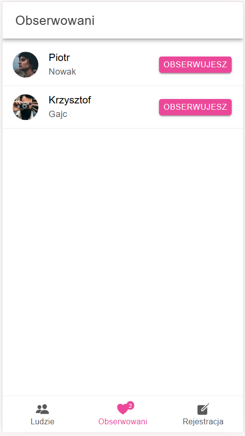
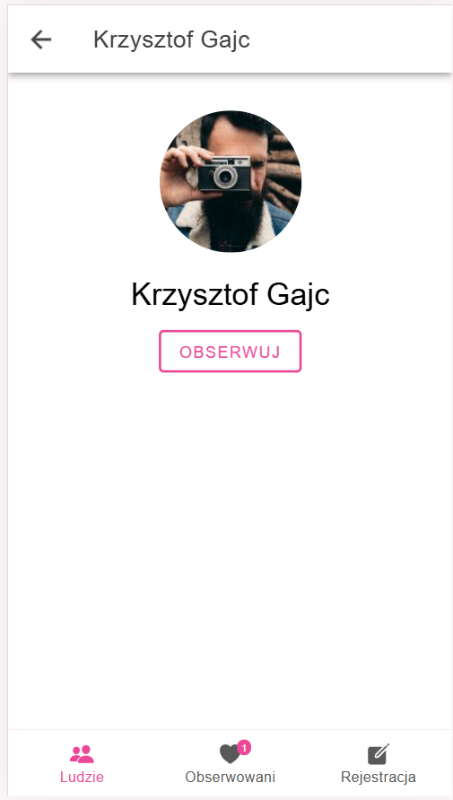
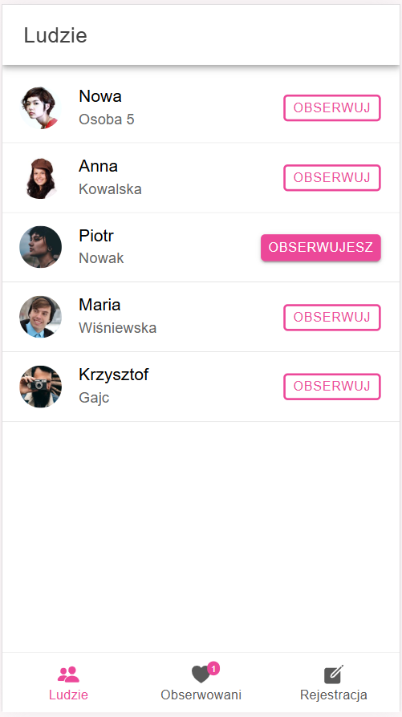
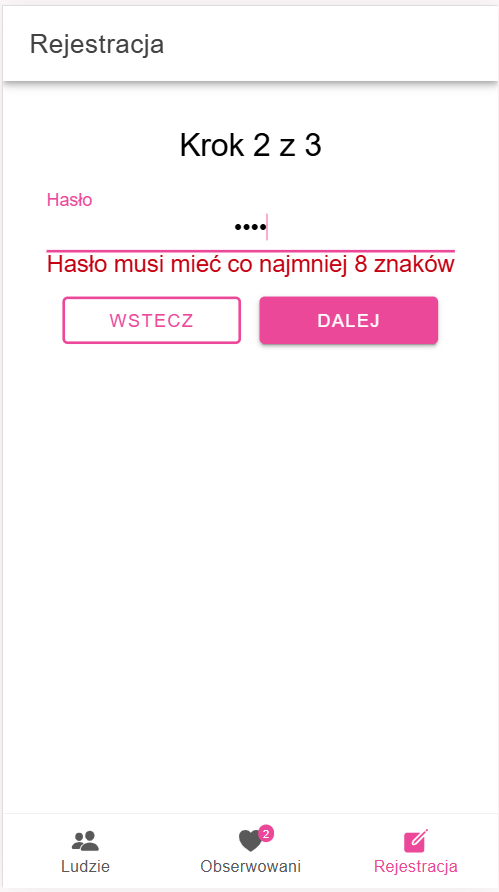
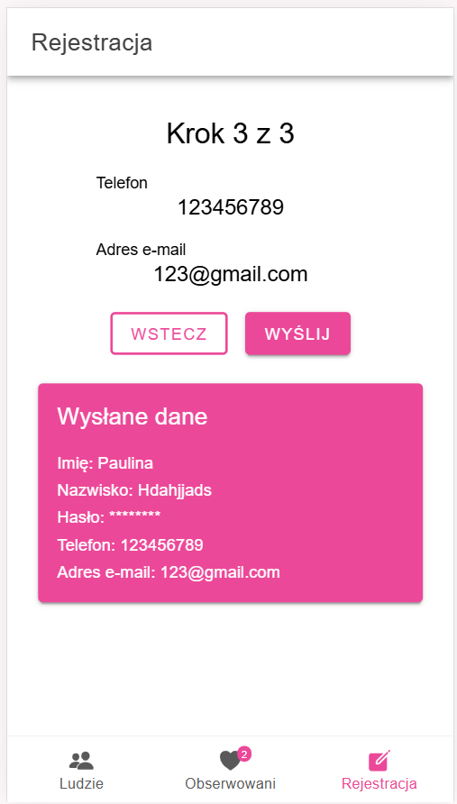

# ✧ Lab 06: Nawigacja, wspólny stan i formularze w Ionic React ✧

## ✦ Co zostało zrealizowane ✦
- Zainicjalizowano projekt mobilny oparty na **Ionic** z szablonem zakładek (`tabs`) w **React** (`ionic start lab_06 tabs --type=react --no-git`) oraz zainstalowano biblioteki `zustand`, `react-hook-form` i `swiper`.
- Dostosowano pasek zakładek (`IonTabBar`, `IonTabButton` w `App.tsx`) pod kątem ikon z pakietu `ionicons/icons` (`people`, `heart`, `create`) oraz etykiet: **Ludzie**, **Obserwowani** i **Rejestracja**.
- Zaimplementowano globalny magazyn stanu aplikacji za pomocą biblioteki **Zustand** (`src/store/peopleStore.ts` oraz dane startowe w `src/data/people.ts`):
  - utworzono akcje `toggleFollowing` oraz `addPerson` operujące na aktualizacjach stanu,
  - zbudowano komponent elementu listy `PersonItem.tsx` z wykorzystaniem `IonItem`, `IonAvatar`, `IonLabel` oraz przycisku `IonButton` zmieniającego status obserwowania w czasie rzeczywistym,
  - zsynchronizowano stan pomiędzy zakładkami **Ludzie** (`Tab1.tsx`) oraz **Obserwowani** (`Tab2.tsx`, z obsługą komunikatu przy pustej liście) oraz dodano licznik obserwowanych osób (`IonBadge`) w pasku zakładek.
- Skonfigurowano routing z parametrem (`/tab1/:id`) oraz utworzono widok szczegółów osoby (`src/pages/PersonDetail.tsx`):
  - odczytano identyfikator z adresu za pomocą hooka `useParams()`,
  - zaimplementowano powrót do listy przyciskiem `IonBackButton` (`defaultHref="/tab1"`), obsługę braku osoby o podanym ID oraz blokadę propagacji zdarzenia kliknięcia przycisku obserwowania na liście (`e.preventDefault()`, `e.stopPropagation()`).
- Dodano mechanizm *pull-to-refresh* na liście osób (`Tab1.tsx`) z wykorzystaniem komponentów `IonRefresher` i `IonRefresherContent` oraz zdarzenia `RefresherCustomEvent`, symulujący pobranie i dopisanie nowej osoby na początek listy po upływie 1 sekundy (`event.detail.complete()`).
- Zbudowano trzyetapowy formularz rejestracji (`Tab3.tsx`) łączący bibliotekę **react-hook-form** (`useForm`, `Controller`, `trigger`, `handleSubmit`) ze slajdami **Swiper** (`Swiper`, `SwiperSlide`, `allowTouchMove={false}`):
  - **Krok 1:** walidacja pól *Imię* oraz *Nazwisko* (`required`),
  - **Krok 2:** walidacja pola *Hasło* (`required`, `minLength: 8`) oraz nawigacja przyciskami `Wstecz` / `Dalej` w siatce `IonGrid`,
  - **Krok 3:** walidacja numeru telefonu (dokładnie 9 cyfr – wyrażenie regularne `/^\d{9}$/`) oraz adresu e-mail (`/^\S+@\S+\.\S+$/`),
  - wyświetlono podsumowanie przesłanych danych w karcie `IonCard` (`Wysłane dane`) z maskowaniem hasła znakami `*`.
- Dostosowano globalną kolorystykę motywu aplikacji w pliku `src/theme/variables.css` (`--ion-color-primary`) oraz przetestowano działanie wszystkich widoków w trybie mobilnym w DevTools.

---

<div align="center">

### 🌸 Zrzuty ekranu 🌸

| Lista osób (`Tab1`) | Lista obserwowanych (`Tab2`) | Szczegóły osoby (`/tab1/:id`) |
| :---: | :---: | :---: |
|  |  |  |

| Lista po odświeżeniu (Pull-to-refresh) | Formularz z komunikatem błędu | Karta z wysłanymi danymi |
| :---: | :---: | :---: |
|  |  |  |

</div>

---

## ✦ Uruchomienie ✦
Wymagane środowisko: **Node.js** oraz zainstalowane **@ionic/cli**.

1. Przejdź do folderu z projektem:
   ```bash
   cd lab_06
   ```
2. Zainstaluj wymagane zależności (w tym `zustand`, `react-hook-form` oraz `swiper`):
   ```bash
   npm install
   ```
3. Uruchom serwer deweloperski aplikacji:
   ```bash
   ionic serve
   ```
4. Podgląd w widoku mobilnym: w przeglądarce otwórz narzędzia deweloperskie (`F12`), a następnie włącz tryb responsywny (*Toggle device toolbar*).

## ✦ Trudności / refleksja (opcjonalnie) ✦
🌸 W sumie to jak ma prowadzący w końcu oficjalnie na imię, bo na planie jest 'mgr J.'? Informacja potrzebna wyłącznie w celach laboratoryjnych. 🌸
